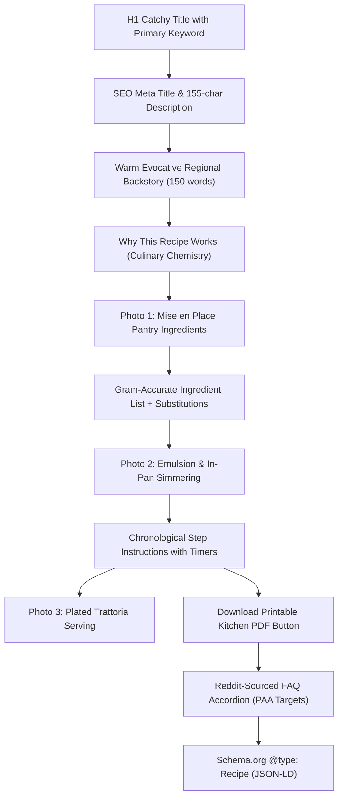

# Italian Recipe SEO Research & Trend Analysis Skill (`/italian-recipe-seo-research`)

Use this skill whenever the user asks to:
1. **Discover High-ROI Italian Recipe Opportunities**: Identify authentic or trending Italian dishes with strong organic search demand ($8,000\text{--}35,000+$ monthly queries) and low-to-moderate SEO competition ($\text{KD} \le 42$).
2. **Conduct Multi-Source Culinary Market Research**: Investigate Google Search SERPs, Reddit communities (`r/ItalianFood`, `r/pasta`, `r/Cooking`, `r/seriouseats`), TikTok/Instagram Reels viral trends, and Pinterest boards.
3. **Audit Competitor SERP Weaknesses**: Identify thin, outdated, paywalled, or intent-mismatched incumbent articles (e.g. recipes adding heavy cream to *Pasta al Limone* or skipping emulsion science in *Pasta alla Gricia*).
4. **Extract Community Pain Points**: Isolate home cook friction points (cheese clumping, broken emulsions, burnt pasta, inaccessible regional ingredients) to craft winning content angles.
5. **Run the Python Opportunity Scoring Engine**: Execute data pipelines to score, rank, and export structured opportunities to JSON and CSV.
6. **Generate Optimized WordPress Recipe Content Blueprints**: Produce articles equipped with Schema.org `Recipe` JSON-LD, 3-stage photography checkpoints, and downloadable PDF kitchen cards.

---

## 1. WordPress Category Framework

All discovered opportunities must be mapped to one of the 6 established culinary categories in the WordPress publication architecture:

1. **Budget-Friendly Italian (`budget-friendly-italian`)**: *Cucina Povera*, pantry pastas, canned legumes (chickpeas, white beans, lentils), day-old bread dishes (*pancotto*, *panzanella*), and meals under $2.00/serving.
2. **Quick Italian Dinners (`quick-italian-dinners`)**: 15–25 minute weeknight dinners, simple sauces, one-pan pastas, and minimal cleanup meals (*Pasta alla Cenere*, *Pasta al Limone*).
3. **Pasta, Risotto & Gnocchi (`pasta-risotto-gnocchi`)**: Authentic sauces, Roman classics (*Zozzona*, *Gricia*), regional shapes, and emulsion-driven pasta dishes.
4. **Regional Italian Recipes (`regional-italian-recipes`)**: Dedicated heritage collections for Emilia-Romagna (*Gramigna con Salsiccia*), Puglia (*Focaccia Barese*), Sicily (*Carrettiera*), Campania, Tuscany, and Sardinia.
5. **Soups, Beans & Vegetables (`soups-beans-vegetables`)**: Peasant broths, legume stews, vegetable stews, and bread soups (*Acquacotta*, *Pasta e Fagioli*, *Ribollita*).
6. **Protein-Rich Italian Meals (`protein-rich-italian-meals`)**: High-protein, balanced dinners with 30g+ protein per serving featuring lean meats or seafood (*Pesce all'Acqua Pazza*, *Straccetti di Manzo*).

---

## 2. Five-Pillar Research Methodology

### Pillar A: Google Search SERP & Competitor Weakness Auditing
- **Target Query Filtering**: Avoid saturated head terms ($\text{KD} > 70$, e.g. "Spaghetti Carbonara", "Lasagna", "Tiramisu"). Focus on semantic long-tail variants ($\text{KD} \le 42$) with clear intent modifiers (`"without cream"`, `"authentic"`, `"easy weeknight"`, `"technique"`).
- **Competitor Dominance Analysis**: Evaluate whether the top 5 ranking URLs are monolithic media brands (DA 85+), paywalled outlets (e.g. *NYT Cooking*), or generic aggregators (*TasteAtlas*, *Wikipedia*) with thin recipe instructions.
- **Intent Mismatches**: Identify queries where top results fail user intent (e.g. users searching for non-dairy/cream-free recipes where top results include heavy cream).
- **Rich Snippets & PAA**: Harvest People Also Ask (PAA) questions to target for Google Featured Snippets and Recipe Rich Cards.

### Pillar B: Reddit & Culinary Community Voice Mining
- **Subreddits Monitored**: `r/ItalianFood`, `r/Cooking`, `r/pasta`, `r/seriouseats`, `r/EatCheapAndHealthy`, `r/Breadit`.
- **Search Patterns**: Look for threads with `[Troubleshooting]`, `"why does my..."`, `"how to stop cheese from clumping"`, `"authentic version of..."`, and complaints about bloated 3,000-word food blog introductions.
- **Top recurring pain points**:
  - *Pecorino Clumping*: Occurs when cheese hits boiling liquid directly instead of forming a warm water-cheese paste off heat.
  - *Curdled Yolks*: Egg mixtures cooking into scrambled eggs in hot sausage/tomato fat.
  - *Rubbery Provola*: Adding smoked provola while the pot is boiling rather than resting for 2 minutes off heat.
  - *Ingredient Accessibility*: Lack of supermarket-friendly substitutes for Italian DOP items (*guanciale*, *provola affumicata*, *provolone del monaco*).

### Pillar C: Social Media & Viral Trend Velocity
- **Platforms**: TikTok, Instagram Reels, Pinterest, YouTube Food Creators.
- **Trend Indicators**:
  - Visual aesthetic appeal (e.g., the striking dark-speckled "ash" look of *Pasta alla Cenere*).
  - Novel cooking techniques that break traditional rules (e.g., frying dry pasta directly in tomato broth for *Spaghetti all'Assassina*).
  - Comfort-food cheese pulls (e.g., Neapolitan *Pasta e Patate*).
- **Recency Filter**: Prioritize dishes gaining momentum over the last 7 to 30 days, differentiating genuine viral acceleration from flat year-round baselines.

### Pillar D: Keyword Demand & Competition Validation
- **Search Volume ($V$)**: Estimated global and US monthly search queries from Google Keyword Planner, Ahrefs, and Google Trends proxies.
- **Keyword Difficulty ($\text{KD}$)**: 0–100 scale representing link profile strength required to crack Page 1.
- **Cost Per Click (CPC)**: Commercial intent indicator for ad RPMs.
- **Seasonality Tracking**: Distinguish between winter comfort dishes (stews, polenta, baked pastas) and spring/summer dishes (citrus, zucchini, seafood).

### Pillar E: High-E-E-A-T Content Blueprint & Conversion
- **Culinary Science ("Why This Recipe Works")**: Explain starch gelatinization, oil-water emulsions, and enzymatic cheese melting.
- **Three Visual Checkpoint Stages**:
  1. *Stage 1 (Mise en Place)*: High-contrast shot of pantry and fresh ingredients.
  2. *Stage 2 (In-Pan Action)*: Emulsion forming in the skillet or simmering broth.
  3. *Stage 3 (Plated Serving)*: Rustic trattoria-style plating with garnishes.
- **Lead Capture & Retention Hook**: Dedicated callout button for a downloadable, printable A4 PDF recipe card.

---

## 3. Mathematical Opportunity Scoring Algorithm

The research engine applies a weighted multi-factor formula yielding a normalized **Opportunity Score (0–100)**:

$$\text{Opportunity Score} = 0.25 \cdot S_{\text{Demand}} + 0.30 \cdot S_{\text{KD Advantage}} + 0.20 \cdot S_{\text{SERP Gap}} + 0.15 \cdot S_{\text{Reddit Friction}} + 0.10 \cdot S_{\text{Trend Velocity}}$$

### Factor Definitions:
1. **$S_{\text{Demand}}$ (25%)**: Log-normalized search volume ($5,000 \le V \le 50,000$):
   $$S_{\text{Demand}} = \max\left(0, \min\left(100, \frac{\log_{10}(V) - \log_{10}(5000)}{\log_{10}(50000) - \log_{10}(5000)} \times 100\right)\right)$$
2. **$S_{\text{KD Advantage}}$ (30%)**: Inverse of Keyword Difficulty:
   $$S_{\text{KD Advantage}} = 100 - \text{KD}$$
3. **$S_{\text{SERP Gap}}$ (20%)**: Content gap, competitor weakness, and paywall leakage score ($0\text{--}10 \times 10$).
4. **$S_{\text{Reddit Friction}}$ (15%)**: Intensity of community troubleshooting queries and complaints ($0\text{--}10 \times 10$).
5. **$S_{\text{Trend Velocity}}$ (10%)**: Social media acceleration and viral momentum ($0\text{--}10 \times 10$).

---

## 4. Automation Engine & Execution Runbook

### Python Environment
- **Python Executable**: Use the installed Python 3.14 environment:
  ```powershell
  & "C:\Users\jacka\AppData\Local\Python\bin\python.exe" scripts/seo_italian_recipe_research_engine.py
  ```

### Running the Pipeline
To evaluate candidate Italian recipe keywords, execute the research script:
```powershell
cd "c:\Users\jacka\Downloads\pinrecipe-scale-engine (1)"
& "C:\Users\jacka\AppData\Local\Python\bin\python.exe" scripts/seo_italian_recipe_research_engine.py
```

### Outputs Produced:
- `output/seo_italian_recipe_opportunities.json`: Complete nested dataset containing primary/secondary keywords, competitor profiles, Reddit pain points, and winning angles.
- `output/seo_italian_recipe_opportunities.csv`: Formatted spreadsheet table ready for Google Sheets or Excel editorial calendars.

---

## 5. On-Page WordPress SEO & Publishing Standard

Every article produced under this skill must adhere to the following strict technical standard:



### Minimum Technical Requirements:
1. **Schema.org JSON-LD**: Include `@context: "https://schema.org"`, `@type: "Recipe"`, `name`, `image`, `author`, `prepTime`, `cookTime`, `totalTime`, `recipeYield`, `recipeCategory`, `recipeCuisine: "Italian"`, `nutrition`, and `recipeInstructions`.
2. **Gram & Volume Measurements**: Provide both metric (grams) and imperial (cups/ounces) to satisfy international searchers.
3. **Pantry Substitutions Table**: Address home cooks who cannot source Italian specialty items (e.g. *guanciale* $\to$ *pancetta* $\to$ *thick-cut bacon with reduced salt*).
4. **Internal Topical Linking**: Cross-link minimum 2 related articles in the same category silo.
